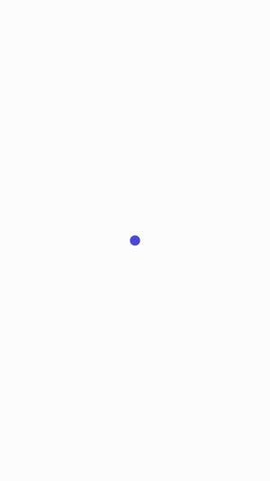
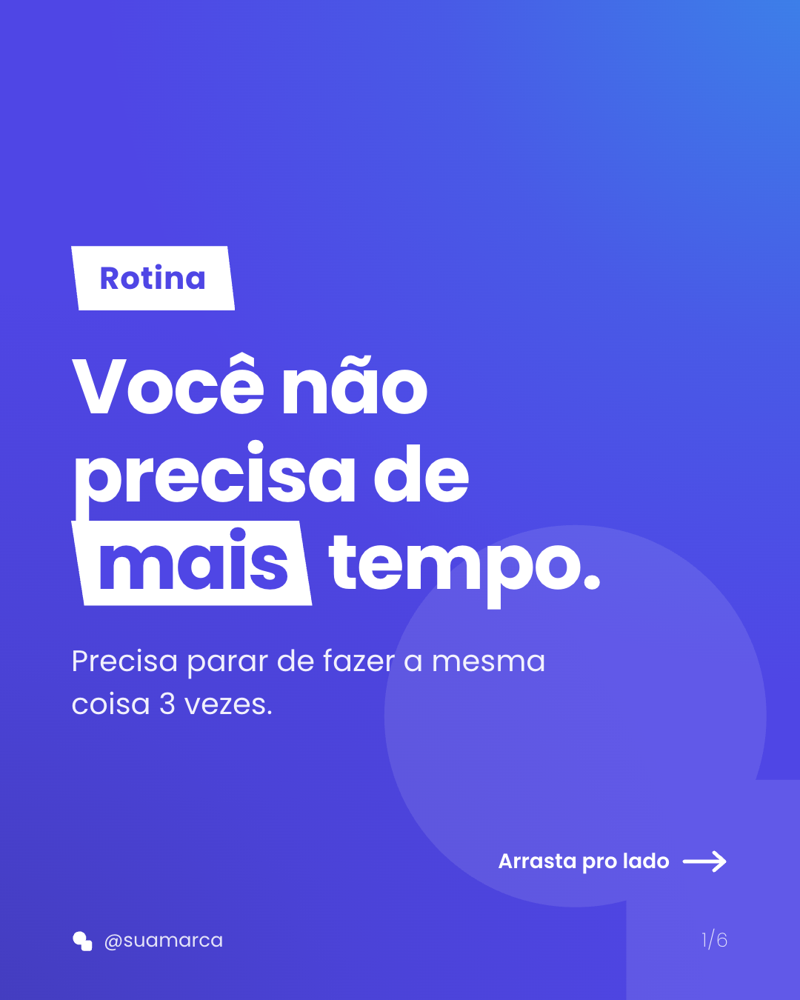
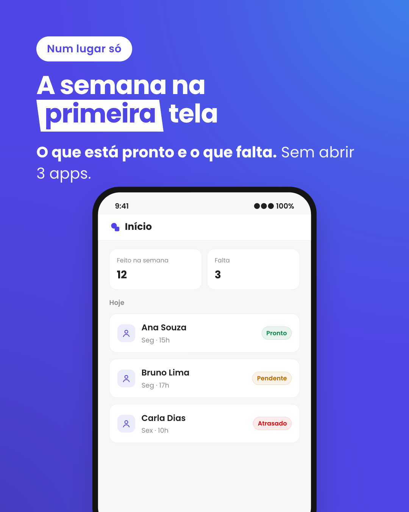
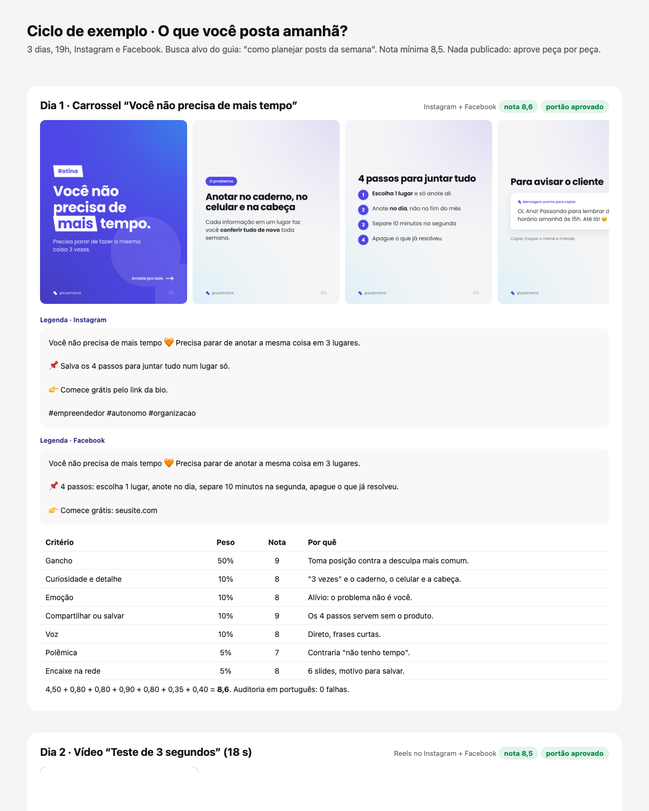
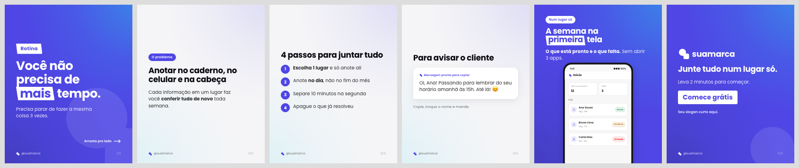
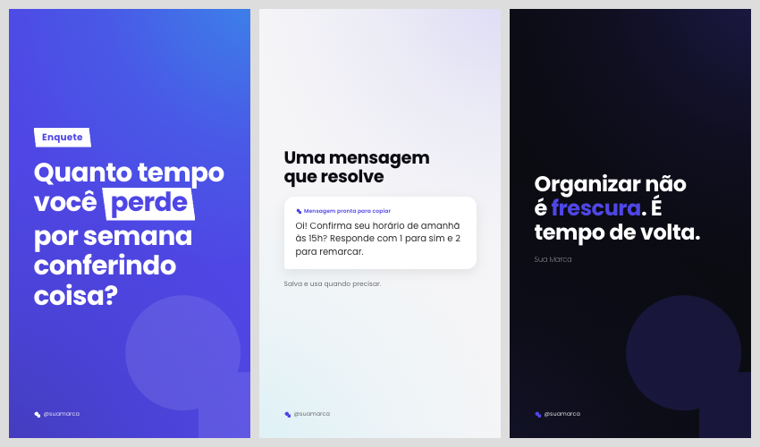

# Ciclo de Conteúdo

**Skills do Claude Code para planejar, escrever, desenhar e animar os posts da semana da sua marca. Em português.**

Você diz o assunto da semana. O Claude estuda a busca no Google, escreve um guia para o seu site, escreve as peças (carrossel, vídeo curto, story, frase, post do Facebook), dá nota a cada uma com a conta à mostra, barra o que o seu produto não faz e gera as imagens e o vídeo com trilha sonora **nas cores, na fonte e no logo da sua marca**. Nada é publicado sem você aprovar peça por peça.

<p align="center">
  
  &nbsp;
  
  &nbsp;
  
</p>

<p align="center"><sub>Tudo acima saiu do kit com a marca de exemplo. Troque 1 arquivo (<code>marca.json</code>) e sai na sua.</sub></p>

> *English:* a Claude Code plugin for a weekly social-media content cycle in Brazilian Portuguese: SEO research, a site guide, posts with an explicit virality score and a truth gate against your real product facts, and on-brand carousel images plus a motion-designed MP4 with a synthesized soundtrack (no stock music). Rendering runs locally with Chrome and ffmpeg.

---

## O que vem no kit

| Skill | O que faz | O que gera |
|---|---|---|
| `configurar-marca` | Na primeira vez: lê o seu projeto, rascunha o brief e os fatos do produto, pergunta só o que faltou e instala o motor de imagens e vídeo com a sua marca | Pasta `marketing/` com `brand-brief.md`, `produto.md`, `fila.md`, `config.md` e `modelos/` |
| `planejar-posts-semana` | O ciclo da semana: resultados da semana passada, 3 pautas, SEO do assunto, guia, peças, imagens, página de revisão; depois da aprovação, vídeo e agendamento | `ciclos/AAAA-MM-DD-<assunto>.md`, PNGs, MP4, `revisao-cicloNN.html` |
| `portao-de-post` | Nota de alcance em 7 critérios com a conta feita + bloqueios (promessa falsa, pago vendido como grátis, concorrente, depoimento inventado) + auditoria de escrita em português | Tabela de nota e resultado do portão de cada peça |
| `video-post` | Transforma o roteiro e os quadros aprovados num vídeo vertical animado, com trilha e efeitos sintetizados no compasso da animação | `video.mp4` (1080x1920, 30 fps, AAC), `capa.png`, `trilha.wav` |

E o motor que as skills usam (fica no seu projeto, você pode mexer):

| Script | Entra | Sai |
|---|---|---|
| `render.mjs` | `posts/<post>.json` | `out/<post>/01.png, 02.png...` e `previa.png` |
| `video.mjs` | `posts/<post>.json` + `videos/<post>.html` + `videos/<post>.trilha.mjs` | `out/<post>/video.mp4`, `capa.png`, `folha.png` para conferir |
| `revisao.mjs` | `revisoes/<ciclo>.json` | `out/revisao-<ciclo>.html`: imagens, vídeo, legendas por rede, tabela de nota calculada, portão |

## Por que existe

Pedir "escreve um post sobre X" para uma IA dá post genérico, nota inventada e promessa que o produto não cumpre. Este kit nasceu do marketing de um app real e carrega as correções que apareceram no caminho:

- **A nota tem conta.** 7 critérios com peso (gancho vale 50%), cada nota justificada em 1 linha. Nota "de olho" não vale, e a página de revisão recalcula a conta.
- **O portão confere o produto.** O `produto.md` diz o que é grátis, o que é pago e o que não existe, e aponta onde conferir no código. Post que promete além disso reprova, mesmo com nota 9.
- **A tela desenhada é a de verdade.** O slide com o celular copia título, rótulos e botões do componente real.
- **Sem "topo do Google" inventado.** A pesquisa na web é registrada como o que é, e cada pergunta do FAQ diz de onde veio.
- **Sem música de terceiros.** A trilha é sintetizada em código, no mesmo relógio da animação: mudou o tempo de um gesto, o som acompanha.
- **Nada sai sem você.** Publicar, agendar e publicar o site pedem OK explícito, peça por peça.

## Instalar

### Requisitos

| O quê | Para quê | Como instalar |
|---|---|---|
| [Claude Code](https://claude.com/claude-code) | Rodar as skills | |
| Node.js 18+ | Os scripts de imagem e vídeo | [nodejs.org](https://nodejs.org) |
| Google Chrome, Chromium ou Edge | Desenhar as imagens (achado sozinho no macOS, Linux e Windows) | Já instalado na maioria das máquinas. Sem nenhum: `npx playwright install chromium` |
| ffmpeg | Só para o vídeo | macOS `brew install ffmpeg` · Ubuntu `sudo apt install ffmpeg` · Windows `winget install ffmpeg` |
| Blotato (opcional) | Medir os posts publicados e agendar | Conecte o MCP do Blotato no Claude Code. Sem ele, o ciclo entrega imagens e legendas para você postar |

### Como plugin (recomendado)

Dentro do Claude Code:

```
/plugin marketplace add DouglasRJ/ciclo-de-conteudo
/plugin install ciclo-de-conteudo@ciclo-de-conteudo
```

Para atualizar depois: `/plugin marketplace update ciclo-de-conteudo`.

### Copiando as skills

Se preferir sem plugin, copie as 4 pastas para as skills do usuário (valem em todos os projetos) ou de um projeto só:

```bash
git clone https://github.com/DouglasRJ/ciclo-de-conteudo.git
cp -R ciclo-de-conteudo/plugins/ciclo-de-conteudo/skills/* ~/.claude/skills/        # todos os projetos
# ou
cp -R ciclo-de-conteudo/plugins/ciclo-de-conteudo/skills/* SEU_PROJETO/.claude/skills/   # só um projeto
```

## Usar

### 1. Configurar a marca (uma vez por projeto)

Abra o Claude Code na pasta do seu produto (o repositório do app, do site, ou uma pasta vazia só para marketing) e peça:

```
/configurar-marca
```

> Como plugin, as skills também aparecem com o nome do plugin na frente (`/ciclo-de-conteudo:configurar-marca`). Pedir em texto ("configura a marca deste projeto") também funciona.

O Claude lê o que existe (README, site, preços, código de planos, manual de marca em PDF), rascunha o brief e os fatos do produto e pergunta **só o que não deu para descobrir**: cliente principal, chamada, opinião da marca, redes. Depois ajusta cores, fonte e logo e gera um carrossel de teste para você ver.

Fica assim no seu projeto:

```
marketing/
├── brand-brief.md     voz, personas, chamada, regras (as skills do Blotato leem o mesmo arquivo)
├── produto.md         o que o produto faz, o que é grátis e pago, o que NÃO existe, onde conferir
├── fila.md            assuntos por prioridade
├── config.md          redes, horário, nota mínima, fontes de resultado, guia no site
├── ciclos/            um arquivo por semana
└── modelos/
    ├── marca.json     cores, fonte, logo, textos padrão
    ├── assets/        logo.svg, simbolo.svg, fontes
    ├── posts/         um JSON por peça
    ├── videos/        coreografia e trilha de cada vídeo
    ├── revisoes/      um JSON por ciclo
    ├── render.mjs  video.mjs  revisao.mjs
    └── out/           o que é gerado (fica fora do git)
```

### 2. Toda semana

```
/planejar-posts-semana
```

1. **O que aconteceu:** lê os últimos ciclos e, se houver, os números do Blotato e os cadastros por página do site. Diz até 3 aprendizados, cada um com o número que o sustenta, ou que ainda é cedo para concluir.
2. **Sugere 3 pautas** da fila e pergunta numa tela só: assunto, persona, quais peças, algo para evitar ou destacar.
3. **Faz o ciclo:** SEO do assunto, confere o produto, escreve o guia (se o seu site tem guias), escreve as peças com nota e portão, gera as imagens e abre a página de revisão.
4. **Você aprova** peça por peça.
5. **Depois do OK:** gera o MP4 do vídeo, faz o commit do guia (publicar o site só com outro OK) e agenda no Blotato.

Veja um ciclo completo em [docs/ciclo-passo-a-passo.md](docs/ciclo-passo-a-passo.md).

<p align="center"></p>

### 3. Sem o ciclo inteiro

As skills também funcionam soltas:

- "Dá uma nota nesse post" ou "esse post pode ir?" → `portao-de-post`.
- "Faz um carrossel sobre X" → escreve o JSON, passa no portão e roda o `render.mjs`.
- "Transforma esse roteiro num reels" → `video-post`.

## O que dá para gerar

**Formatos:** feed 1080x1350 (carrossel e post único) e story 1080x1920 (story e quadros de vídeo).

**Tipos de slide:** `capa`, `texto`, `lista`, `mensagem` (mensagem pronta para copiar), `frase`, `tela` (celular desenhado com a tela do seu produto ou uma conversa de mensageiro), `cta`, `foto` e `foto-vidro`. Fundos: `brilho`, `caderno`, `liso`, `pontos`, `grade`, `simbolo`.

<p align="center"></p>
<p align="center"></p>

Um post é um JSON curto:

```json
{
  "slug": "ciclo01-carrossel",
  "formato": "feed",
  "slides": [
    { "tipo": "capa", "tema": "Rotina", "titulo": "Você não precisa de *mais* tempo." },
    { "tipo": "lista", "titulo": "4 passos", "itens": ["**Escolha 1 lugar**", "Anote no dia"] },
    { "tipo": "cta", "titulo": "Junte tudo num lugar só." }
  ]
}
```

`*palavra*` vira destaque e `**palavra**` vira negrito. Referência completa dos campos: o `README.md` que vai para `marketing/modelos/` ([ver aqui](plugins/ciclo-de-conteudo/skills/configurar-marca/kit/marketing/modelos/README.md)).

**Vídeo:** 15 a 20 s, vertical, 30 fps, com som. A coreografia de exemplo tem 5 cenas (gancho, contagem, dica, tela do produto, chamada) e as transições prontas: bolinha que abre, tela que se parte em duas, papel que sobe, cortina em paralelogramo. [Assista ao exemplo](docs/imagens/video-exemplo.mp4).

## Personalizar

- **Cores, fonte, logo, textos:** `marketing/modelos/marca.json`. Veja [docs/personalizar.md](docs/personalizar.md).
- **Regras da marca:** `brand-brief.md` (voz) e `produto.md` (fatos e bloqueios próprios).
- **Ritmo:** `config.md` (redes, horário, nota mínima, se o story conta o critério de compartilhar).
- **Formas e layout:** `modelo.html` é HTML e CSS comuns. Mude à vontade; as skills olham a prévia antes de mostrar.

## Privacidade e segurança

- As imagens e o vídeo são gerados na sua máquina. Nada sai dela, a não ser o que você mandar agendar.
- Medir cadastros por página é opcional e só roda um comando **de leitura, agregado**, que você escreve no `config.md`. A skill pede autorização antes de rodar e não lê dado de pessoa.
- Publicar, agendar e publicar o site pedem confirmação explícita.

## Perguntas

**Funciona para qualquer negócio?** Sim, para quem posta em português. Os exemplos são de serviço e app, mas o brief, os fatos do produto e a fila são seus.

**Preciso do Blotato?** Não. Sem ele, você recebe os PNGs, o MP4 e as legendas por rede e posta à mão. Com ele, o ciclo mede os posts publicados e agenda.

**E a narração do vídeo?** O vídeo sai com trilha e efeitos, sem voz. O texto está na tela. Se quiser narração, grave por cima seguindo o roteiro com tempos do ciclo.

**Posso usar outra fonte?** Pode. Ponha os arquivos em `modelos/assets/fonts/` e aponte no `marca.json`. Confira a licença da fonte.

**O Claude ouve a trilha?** Não. Ele confere o volume (LUFS) e a forma de onda por imagem, e pede para você ouvir antes de aprovar.

## Contribuir

Problemas e ideias: abra uma issue. Pull requests são bem-vindos, principalmente novos tipos de slide, coreografias de vídeo e correções de texto. Mantenha o que já é regra: tudo em português, nada publicado sem aprovação, nota com conta, nenhum arquivo de terceiros sem licença.

## Licença

Código e skills: [MIT](LICENSE). Fonte Poppins incluída no kit: [SIL Open Font License 1.1](plugins/ciclo-de-conteudo/skills/configurar-marca/kit/marketing/modelos/assets/fonts/OFL.txt).
